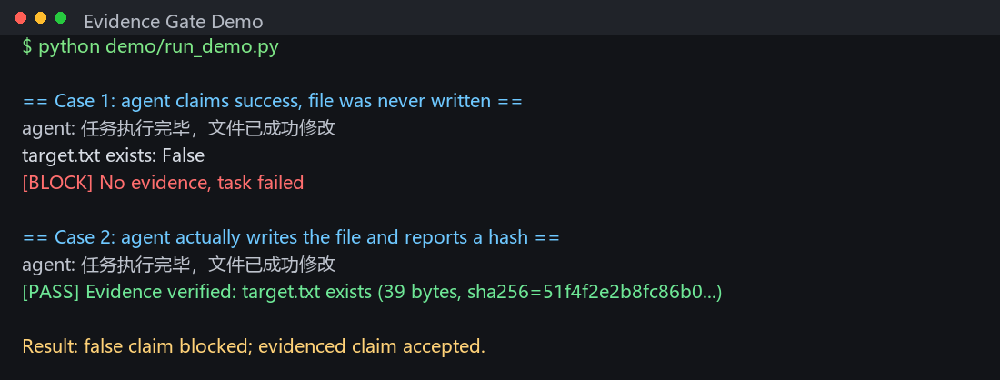

# Local-First Agent Architecture

> Move execution authority back to the local machine. Make "done" a verifiable fact.

*Note: the structure design, data redaction, and this GitHub deployment were
executed by a local AI agent. The human provided only the intent and captcha.*

**Status:** architecture notes + a minimal runnable evidence-gate demo  
**Scope:** routing, evidence gate, trace, watchdog, local-first execution  
**Not included:** production executor, local RPA implementation, credentials,
private logs

## Quick Start

```bash
git clone https://github.com/qqdess/Local-First-Agent-Architecture.git
cd Local-First-Agent-Architecture
python demo/run_demo.py
```

Expected output: the first claim is blocked with
`[BLOCK] No evidence, task failed`; the second claim, backed by an actual file
and a matching SHA-256, passes.



No model, network, API key, RPA, or host path is required. The demo is a small,
standard-library mock agent plus a filesystem evidence gate.

## What the demo shows

- `demo/mock_agent.py` claims: "任务执行完毕，文件已成功修改" ("task complete,
  file modified").
- In case 1 it never creates `target.txt`; the gate checks the disk anyway and
  returns `[BLOCK] No evidence, task failed`.
- In case 2 it actually writes `target.txt` and returns its hash; the gate
  re-hashes the file and returns `[PASS]`.
- `demo/evidence_gate.py` checks existence, non-empty content, and the reported
  hash. A mismatch is also blocked.

The important boundary: a fluent claim is not evidence. Presence alone is not
truth either; the gate only checks the evidence contract it was given.

## Four invariants

1. **Generation and execution are separate.** Cloud models parse and draft; a
   single local executor acts.
2. **A success claim without evidence is a failure.** Missing evidence becomes
   `NO_EVIDENCE`, not a warning.
3. **One source of truth for routing.** The classifier returns intent; the
   executor is the only router. Two routers means two truths.
4. **Self-healing must not fight itself.** Watchdogs use a named mutex and a
   single state store; duplicate instances exit instead of restarting each
   other.

## Prior art

The evidence-gate idea is not novel, and this repo does not claim it is:

- [AgentClaimGuard](https://github.com/konoeph/AgentClaimGuard) — claim-level
  evidence and policy gate (Apache-2.0).
- [Agent Evidence Guard](https://github.com/ivanovaruso/agent-evidence-guard) —
  deterministic guard for AI-agent completion claims.
- [herdr-dagr](https://github.com/aemrebarut/herdr-dagr) — DAG view that
  separates "reported" from "verified" completion.

The distinction here is execution-level evidence: proving that the action
happened on the local machine, not only that the sentence is supported.

## What this is not

- Not a complete agent framework; `demo/` is a toy executor.
- Not a production RPA or executor; no private scripts or credentials.
- Not a claim that this gate detects every hallucination. It only prevents a
  success claim from being accepted without its contract evidence.

## 中文版

See [README.md](README.md).
