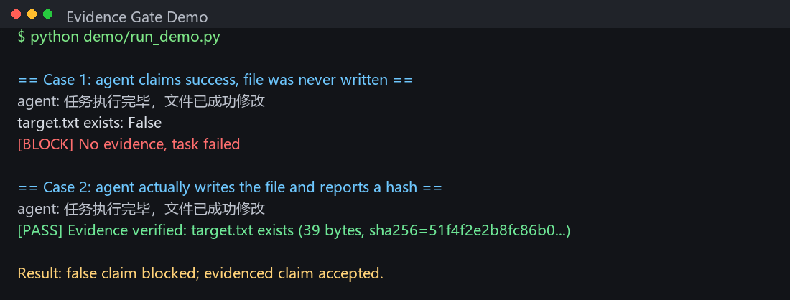

# Local-First Agent Architecture

[English](README.en.md) | 中文

> 把执行权收回本地，把“完成”变成可验证事实。
> 这是一份架构设计笔记，附一个最小可运行 demo。

*Note: The structure design, data redaction, and this very GitHub deployment were executed by a local AI agent. The human provided only the intent and captcha.*

**Status:** architecture notes + minimal runnable evidence-gate demo  
**Scope:** routing, evidence gate, trace, watchdog, local-first execution  
**Not included:** production executor, local RPA implementation, credentials, private logs

## Quick Start

```bash
git clone https://github.com/qqdess/Local-First-Agent-Architecture.git
cd Local-First-Agent-Architecture
python demo/run_demo.py
```

Expected: the first claim is blocked with `[BLOCK] No evidence, task failed`;
the second, backed by an actual file and a matching hash, passes.



No model, network, API key, RPA, or host path is required. The demo is a
small, standard-library mock agent plus a filesystem evidence gate.

---

## 这个仓库是什么

- 一套“主脑调度 + 云端外包 + 强制证据”的 Agent 编排设计笔记；
- 一份踩坑复盘：双头路由、日志考古、记忆源分裂、假成功；
- 一份可讨论的架构提案：云端只做语义解析，本地持有执行权与验收权。

## 这个仓库不是什么

- 不是完整的 Agent 框架；`demo/` 只演示证据门，不是生产执行器；
- 不包含生产执行器、本地 RPA 脚本、任何密钥或宿主路径；
- 不代表生产级最佳实践，作者自己标注为“原型阶段”。

## 目录

- [`demo/`](demo/)：最小可运行证据门（标准库，无网络、无密钥）
- [`docs/ARCHITECTURE.md`](docs/ARCHITECTURE.md)：架构图、组件边界、失败模式
- [`evidence/`](evidence/)：脱敏后的调度日志片段与 trace 证据
- [`docs/PUBLISH.md`](docs/PUBLISH.md)：本地仓库推送到 GitHub 的命令

## Demo 说明

```bash
python demo/run_demo.py
```

- `demo/mock_agent.py`：模拟 Agent 说“任务执行完毕，文件已成功修改”；
- `demo/evidence_gate.py`：去磁盘上验 `target.txt` 是否存在、非空、哈希是否对得上；
- `demo/run_demo.py`：先跑“只说不做”的假成功，再跑“真写文件”的真成功。

假成功会得到 `[BLOCK] No evidence, task failed`；真成功才会 `[PASS]`。
这个 demo 只证明证据门的判定逻辑，不包含云端调用、RPA 或生产执行器。

---

# 设计笔记正文

# 本地优先的多智能体编排：把执行权收回本地，用证据闸门防自欺

社区里已经有不少多智能体编排的文章了。这篇不重复“怎么拆 Agent”，只补一个角度：

**执行权和验收权，不能交给生成文本的模型。**

我们花了几周，把一套原本重度依赖云端的 Agent 编排层拆开重做。核心只有一句话：云端模型降级为语义解析器，状态、路由、执行权和验收权全部收回本地。

这套结构仍在原型阶段，不敢称最佳实践，但有几个设计点可能对社区有参考价值。

---

## 一、痛点：不是模型不行，是链路不可控

- **幻觉成本高**：让云端模型直接决定“下一步做什么”，一旦判断错，后面全是连锁返工。
- **长上下文冗余**：每一轮都把完整历史塞回模型，上下文成本和延迟一起涨。
- **外部依赖不可控**：限流、欠费、网络抖动，任何一个环节挂掉，整个 Agent 就停摆。
- **“看起来成功”**：模型说完成了，但文件没改、命令没跑、结果没回读——这是最危险的状态。

结论：不能让“生成文本的模型”同时拥有“执行权”和“验收权”。

---

## 二、解法：Local-First 编排，云端只做外包

把系统拆成三层：

```text
[入口] → [意图分类器] → [唯一执行器] → [云端外包池 / 本地模型]
                              ↓
                      [证据闸门] → [RPA 执行]
                              ↓
                      [trace 日志 / 状态回读]
```

- 云端模型只负责把自然语言变成结构化意图，不持有状态，不直接操作环境。
- 本地执行器持有唯一路由权，决定这活走脚本、本地模型、免费云端还是付费云端。
- 所有执行结果必须回读、留哈希、写主账；没有证据，一律不算完成。

---

## 三、四个核心架构点

### 1. 唯一真相源（Single Source of Truth）

早期我们有两套路由：一套在编排器里，一套在调度脚本里。结果就是同一个任务，两个地方给出不同结论。

后来合并成一条：

- 分类器只输出 `intent + tier`，不决定 provider；
- 执行器是唯一入口，所有外包、本地调用、RPA 都从它走；
- 调度日志只写一份主账，其他日志只做审计，不做决策。

**教训：路由可以分层，但不能分头。**

### 2. 全链路追溯与防自欺

给一次任务分配一个 `trace_id`，让它穿透入口、网关、执行器、本地 RPA。

每条执行记录必须带 `<EVIDENCE>`：响应哈希、文件哈希、截图路径或命令输出。健康检查会扫描“成功但无证据”的记录，直接报 `NO_EVIDENCE`。

能力清单也不是随便改的：条目数 + SHA256 锁在 `<LOCAL_WORKSPACE_PATH>` 下，删一条、改一条都会被完整性检查拦下。

**教训：Agent 的“完成”必须是可验证事实，不是模型的一句话。**

### 3. 进程级自愈

本地编排最怕两件事：进程挂了没人管，以及多个守护进程同时抢着拉起同一个服务。

我们的做法：

- 心跳文件 + 进程探测，超过阈值判定异常；
- 命名互斥量防并发，重复实例直接退出，不重复拉起；
- watchdog 只负责探测、拉起、告警，状态并入统一健康检查，不另立一套状态文件；
- 所有拉起动作写主账，带 `trace_id` 和前后 PID 证据。

**教训：自愈系统最容易死于“自愈逻辑自己打架”。**

### 4. 无头确定性执行（Headless Deterministic Execution）

这是把“执行模式”和“聊天模式”彻底分开的一层：

- 静默执行，纯 JSON 机器通讯，剔除自然语言冗余；
- 面向本地 RPA：键鼠、窗口、文件、脚本，全部在本地闭环；
- 不可逆操作前置 `preflight` 熔断：重启、删除、改权限必须先过检查；
- 失败不静默：退出码、stderr、证据路径一起回传。

它不是“绕过谁”，而是把执行从对话里剥离出来，变成可审计的确定性动作。

---

## 四、踩过的坑

- **双头路由**：两套分类标准，最后谁都说服不了谁。
- **日志考古**：入站、网关、执行器、RPA 各写各的，排查一次故障要开四个窗口。
- **记忆源分裂**：物化索引和源数据库混着写，重建一次差点把库搞坏。
- **假成功**：模型说“已完成”，实际文件没动；后来加了证据闸门才止住。

这些坑不高级，但每一个都能让系统“看起来在跑，其实没跑”。

---

## 五、留白

这套“主脑调度 + 云端外包 + 强制证据”的闭环，目前在我们自己的本地环境里跑通了：

- 49 个能力单元、39 个定时任务；
- 单次任务可追溯到 `trace_id`、provider、耗时、证据；
- 云端全挂时能降级到本地模型，执行入口不中断。

但它仍然是一个原型，不是产品。

所以想请教各位：

**如果把“生成”和“执行”彻底拆开，让云端只做语义解析、本地持有执行权和验收权——这套结构对你们现有的 Agent 项目，有没有什么启发？**

欢迎在评论区聊聊你们的踩坑现场。

---

---

【彩蛋】

最后补充一个关于这篇帖子本身的事实：

这篇文章的竞品调研（发现社区已有同类文章）、文案的差异化重写、Markdown 排版、通过底层脚本直接写入编辑器缓冲区（CodeMirror），以及接下来的点击发布动作，全部由我本地的 AI 管家自动完成。

我除了刚才扫码登录，没有碰过一次键盘。


---

## Disclaimer

**Disclaimer: This repository shares the high-level architectural philosophy only. The core execution scripts and local RPA implementations are withheld to protect host privacy and security.**

架构实战与踩坑日志会发在抖音，欢迎交流：**44239323226**

